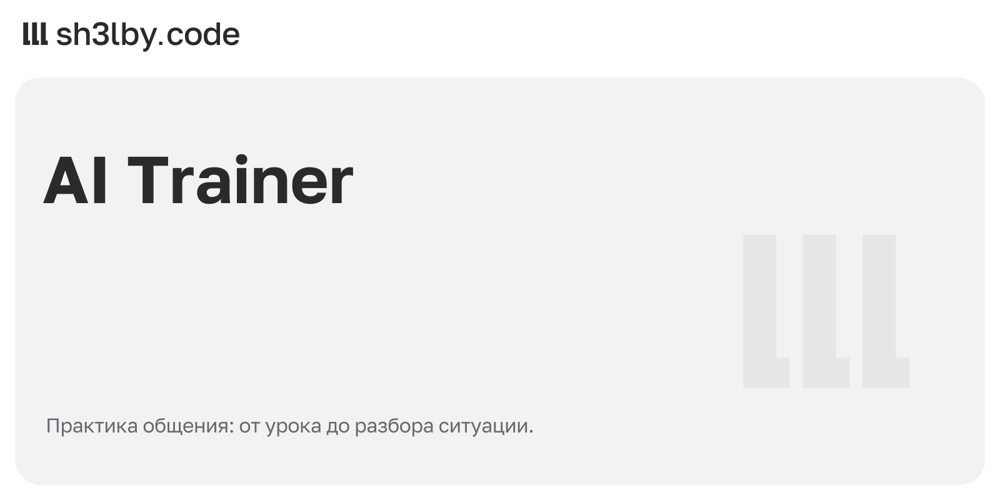

# AI Trainer

<!-- portfolio-card:start -->
[](docs/portfolio/card.svg)
<!-- portfolio-card:end -->

Telegram bot that trains communication skills: structured lessons (block → lesson → step), quizzes, points and insights, plus an LLM that analyses user-written situations and flags toxic phrasing. Ships with an HTTP API so a website can run the onboarding quiz and hand results back to the bot.

## Features

- **Lessons**: modules loaded from JSON (`docs/training_module_format.md`), progress and scoring per user, scheduler for reminders.
- **Onboarding**: 15-question quiz either inside the bot or as a WebApp on your site, with results delivered via REST or a Supabase poller.
- **AI analysis**: two prompt models (`models/analysis.md`, `models/toxic.md`) dispatched through AtlantSDK, an aiogram-style router for LLM calls (handlers, filters, priorities, CAS-safe sessions).
- **Admin**: broadcast, user management, insight editor, lesson import tools (`lessons_export_tools/`).
- **API server** (`api_server.py`): aiohttp, per-IP rate limiting, endpoints for quiz results and user lookup.

## Stack

Python 3.11+, aiogram 3.13, aiohttp, aiosqlite, pydantic 2, google-generativeai. SQLite for storage. No Docker needed: one process runs the bot, the API server and the poller.

## Run

```bash
python3 -m venv .venv && .venv/bin/pip install -r requirements.txt
cp .env.example .env     # TELEGRAM_BOT_TOKEN, GEMINI_API_TOKEN, ADMIN_IDS
.venv/bin/python main.py
```

Import a lesson module:

```bash
.venv/bin/python -m lessons_export_tools.import_lessons_from_json lessons_export_tools/lessons.json
```

Production: `deploy/setup.sh` + `deploy/bot.service` (systemd).

## Layout

```
main.py                  entry point: bot + API server + poller
api_server.py            aiohttp API with rate limiting
core/                    config, async SQLite, DI container, bot<->LLM bridge
bot/                     aiogram handlers, keyboards, FSM states, services, repositories
atlant/                  LLM-side routers and handlers (analysis, toxicity)
AtlantSDK/               LLM dispatcher library (routers, filters, model registry)
models/, models.json     system prompts and model registry
lessons_export_tools/    lesson JSON + import / migration scripts
docs/                    architecture, modules, onboarding integration, lesson format
```

## License

MIT
